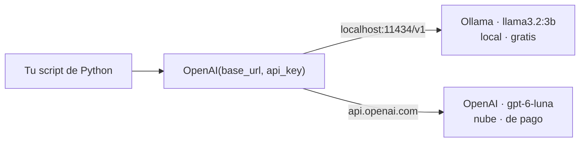

# Tu primer LLM desde Python: API de OpenAI o gratis con Ollama


Código del **video 2** del minicurso gratuito **Agentes de IA con Python desde cero**, de [Datos Dinámicos](https://datosdinamicos.com).

Con un mismo código le hablas a un modelo **local y gratis** (Ollama) o a uno **en la nube** (OpenAI). Para cambiar de uno a otro, cambias una sola palabra en la terminal:

```bash
uv run 01_primera_llamada.py          # llama3.2:3b en tu computador, gratis
uv run 01_primera_llamada.py openai   # gpt-6-luna en la nube de OpenAI
```

## La idea en un dibujo

Ollama expone la misma API que OpenAI. Por eso basta con la librería oficial `openai`: solo cambian la URL, la clave y el modelo.



## Antes de empezar

| Necesitas | Para qué |
|---|---|
| [Python 3.12+](https://www.python.org/downloads/) | Ejecutar los scripts |
| [uv](https://docs.astral.sh/uv/) (recomendado) o `pip` | Instalar las librerías |
| [Ollama](https://ollama.com) | Correr el modelo gratis en tu computador |
| Una API key de [OpenAI](https://platform.openai.com/api-keys) (opcional) | Solo si quieres probar el modelo en la nube |

## Cómo ejecutarlo

1. **Clona el repositorio**
   ```bash
   git clone https://github.com/AndresInsuasty/tu-primer-llm-desde-python.git
   cd tu-primer-llm-desde-python
   ```

2. **Descarga el modelo local** (unos 2 GB, no necesita GPU)
   ```bash
   ollama pull llama3.2:3b
   ```

3. **Crea tu archivo `.env`** a partir de la plantilla
   ```bash
   cp .env.example .env
   ```
   Si vas a usar OpenAI, pega tu clave en `OPENAI_API_KEY`. Si solo usas Ollama, déjalo como está.

4. **Ejecuta los scripts**
   ```bash
   uv run 01_primera_llamada.py
   ```
   uv instala las librerías la primera vez. Si prefieres pip:
   ```bash
   pip install -r requirements.txt
   python 01_primera_llamada.py
   ```

## Los archivos

| Archivo | Qué hace |
|---|---|
| [`llm.py`](llm.py) | Configuración de los dos proveedores y la función `crear_cliente()`, que te devuelve el cliente y el modelo listos. |
| [`01_primera_llamada.py`](01_primera_llamada.py) | Tu primera pregunta a un LLM, con un mensaje de sistema y uno de usuario. |
| [`02_tokens_y_costos.py`](02_tokens_y_costos.py) | Cuántos tokens gastó la llamada y cuánto costó. |
| [`03_comparar.py`](03_comparar.py) | La demo del video: la misma pregunta a Ollama y a OpenAI, con tiempo y tokens. |
| [`04_streaming.py`](04_streaming.py) | Bonus: la respuesta aparece mientras se escribe, como en un chat. |

Todos aceptan el proveedor como argumento (`ollama` u `openai`). Si no le pasas ninguno, se usa el `PROVEEDOR` de tu `.env`, y si tampoco está, Ollama.

## ¿Cuánto cuesta?

El precio se cobra por millón de tokens, y los de salida cuestan más que los de entrada:

```
costo = (prompt_tokens × precio_entrada + completion_tokens × precio_salida) / 1.000.000
```

| Modelo | Entrada (USD / 1M tokens) | Salida (USD / 1M tokens) |
|---|---|---|
| `llama3.2:3b` (Ollama) | $0 | $0 |
| `gpt-6-luna` (OpenAI) | $0,10 | $0,50 |

Una llamada corta con `gpt-6-luna` cuesta cerca de **$0,000019**. Los precios cambian: revisa la [página de precios de OpenAI](https://openai.com/api/pricing/) el día que lo uses y actualiza `PRECIOS_POR_MILLON` en `02_tokens_y_costos.py`.

## Errores comunes

| Error | Causa | Solución |
|---|---|---|
| `APIConnectionError` | Ollama no está corriendo | Abre la app de Ollama o ejecuta `ollama serve` |
| `NotFoundError` (404) | El modelo está mal escrito o no lo has descargado | Revisa con `ollama list` y descárgalo con `ollama pull llama3.2:3b` |
| `AuthenticationError` (401) | La clave de OpenAI es incorrecta o no tiene permisos | Revisa `OPENAI_API_KEY` en tu `.env` |
| `Falta OPENAI_API_KEY...` | No hay clave en el `.env` | Copia `.env.example` como `.env` y pega tu clave |

> [!WARNING]
> Nunca subas tu archivo `.env` a GitHub ni lo muestres en pantalla: con tu clave cualquiera puede gastar tu saldo. Este repositorio ya lo incluye en el `.gitignore`.

## Minicurso Agentes de IA con Python desde cero

1. [Qué es un agente de IA, en 30 líneas de Python](https://github.com/AndresInsuasty/agente-ia-30-lineas-python)
2. **Tu primer LLM desde Python: API de OpenAI o gratis con Ollama** (este repositorio)
3. Próximamente: respuestas en JSON confiable con Pydantic

## Reto

Agrega un tercer proveedor a `PROVEEDORES` en `llm.py`, por ejemplo otro modelo de Ollama (`ollama pull qwen2.5:3b`), y compáralo en `03_comparar.py`.

Cuéntanos en los comentarios del video qué modelo te corrió en tu computador.
